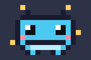
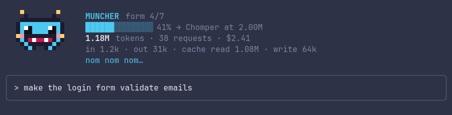
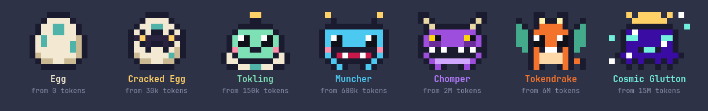

# token-pet

A tiny pixel-art creature that lives above your Claude Code prompt and **feeds on the tokens your conversation spends**. The more tokens you use, the more it grows: it starts as an egg and evolves through seven forms.

<p align="center">
  
</p>



> The images are rendered from the mod's own sprite code. In your terminal it draws the same way, with a transparent background, so it sits on top of your terminal's own background.

## The seven forms



| Form | Unlocks at |
| --- | --- |
| Egg | 0 tokens |
| Cracked Egg | 30k |
| Tokling | 150k |
| Muncher | 600k |
| Chomper | 2M |
| Tokendrake | 6M |
| Cosmic Glutton | 15M |

## What it shows

- **The creature** (5 rows tall), animated:
  - idle, it shuffles from foot to foot (the egg wobbles);
  - while Claude works, it chomps and little gold tokens fly into its mouth;
  - when it evolves, it flashes and sparkles, and you get a toast.
- **Stats next to it:**
  - its form and a progress bar toward the next one;
  - tokens eaten, number of model requests, and cost so far;
  - the breakdown: input, output, cache read, cache write;
  - its mood (`nom nom nom…`, `digesting`, `zzz…`).

Every model request in the conversation counts, subagents included, and so does every token type. Cache reads are usually most of it. `/clear` starts a new conversation, so it also starts a new egg.

## Install

You need a recent Claude Code with support for hooks-module plugins (mods). This mod was built and tested on Claude Code 2.1.322.

At the prompt of a Claude Code terminal session:

```
/plugin install token-pet --marketplace QuintusAlp/token-pet
```

Answer `y` to add the marketplace, then press Enter to pick the user scope. The pet appears above your prompt right away, and in every session after that.

Or from a shell:

```sh
claude plugin install token-pet --marketplace QuintusAlp/token-pet
```

In the Claude desktop app, where `/plugin` does not run, click **+** next to the prompt box. Choose **Plugins**, then **Add marketplace**, enter `QuintusAlp/token-pet`, and click **Add plugin**.

## Use

| Command | What it does |
| --- | --- |
| `/pet` | Put the pet away, or bring it back |
| `ctrl+x ctrl+a` | Collapse or expand the band above the prompt |

The pet steps aside on its own when a survey uses the space above the prompt, or when there is not enough room for it.

## Test and develop it yourself

### 1. Get the code

```sh
git clone https://github.com/QuintusAlp/token-pet.git
cd token-pet
```

### 2. Run Claude Code with your local copy

```sh
claude --plugin-dir .
```

This loads the mod from the folder instead of the installed version. Edits to the files reload the mod when Claude's current turn ends, so you can tweak and watch.

### 3. Check it

```sh
claude plugin validate .   # reads the manifest and the hooks module the way Claude Code will
claude plugin test .       # runs tests/*.test.tsx in a simulated session
```

The tests check that every sprite is 12×10 and uses only its own palette. They also check that a fresh conversation shows an egg, that 700k tokens show a Muncher, and that the band steps aside when it has no room.

### 4. Type-check (optional)

Once Claude Code has loaded the mod (step 2), it writes the API's type declarations to `.claude-plugin/types/`. Then:

```sh
npx -p typescript tsc -p .
```

### 5. Watch it evolve quickly

The thresholds are the `at:` values in `hooks/sprites.ts`. Lower them temporarily, for example `at: 1_000`, `at: 2_000` and so on, then chat a little and watch it go through every form.

## How it works

| File | What's inside |
| --- | --- |
| `hooks/register.tsx` | The logic |
| `hooks/sprites.ts` | The art and the evolution thresholds |
| `types/index.d.ts` | The shape of the state the mod keeps |
| `tests/band.test.tsx` | The tests |

- **Counting tokens.** A `turn.step` hook runs after every model request and adds that response's `usage` to a total. The total is kept in the session's state, so it survives reloads.
- **Drawing.** A `ui.render` hook for the `AbovePrompt` component returns the band: the creature on the left, the stats on the right.
- **Pixel art.** Each form is a 12×10 grid of letters, each letter mapped to a color in its palette. Every terminal cell shows two pixels with the half-block character `▀`: its foreground color is the top pixel and its background color is the bottom one. That makes the pixels square, so a 14×10-pixel canvas is just 14 columns × 5 rows. Empty pixels use the terminal's default background, which is why the pet looks transparent.
- **Animation.** A 250 ms timer repaints only the creature, with `$.ui.blit`, without redrawing the rest of the band.

### Customize

- **Colors and art:** edit the `palette` and `rows` of each form in `hooks/sprites.ts`. Each row must stay 12 characters long, and `.` means transparent.
- **Mouth animation:** the `chomp` rows are swapped in on alternate frames while it eats.
- **Evolution speed:** change the `at:` thresholds.

## License

MIT
